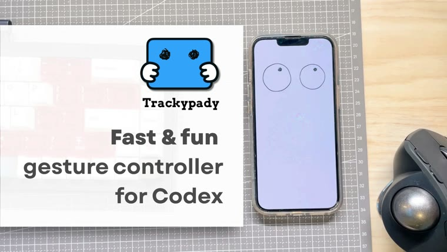

# Trackypady

An iPhone gesture companion for fast and fun control of Codex on your Mac.

Created by **Sandra Feng and Cass Blonbou**.

- [Get the iPhone app on TestFlight](https://testflight.apple.com/join/EB1YQ63W)
- [Mac setup and download](https://deepinteractionlab.github.io/trackypady/)
- [Using Trackypady](docs/using.md) · [Build from source](docs/building.md)
- [Help](https://deepinteractionlab.github.io/trackypady/support/) · [Privacy](https://deepinteractionlab.github.io/trackypady/privacy/)
- [Bridge releases](https://github.com/deepinteractionlab/trackypady/releases)

## Watch the demo

Start with **Try gesture demo** on iPhone—no Mac needed. For live control, install Trackypady Bridge on your Mac and scan its QR using **Scan to pair** in the iPhone app. The distributed Bridge supports Apple silicon and macOS 14 or later. Codex must be installed separately.

This repository contains reviewed source snapshots, the product website and Mac installers. DIL maintains development and official releases separately. Outside code contributions are not being accepted at this stage; questions and feedback are welcome through Help.

Code is licensed under [Apache 2.0](LICENSE). See [asset terms](ASSETS.md) and [third-party notices](THIRD_PARTY_NOTICES.md). Trackypady is an independent companion developed by Deep Interaction Lab, not an OpenAI product.
